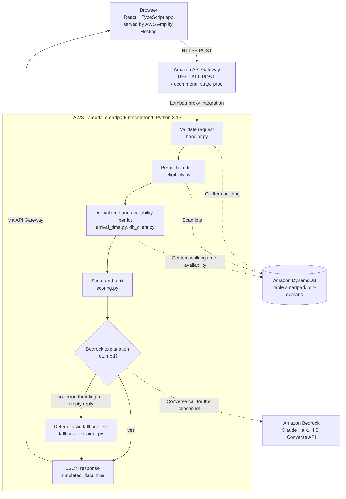
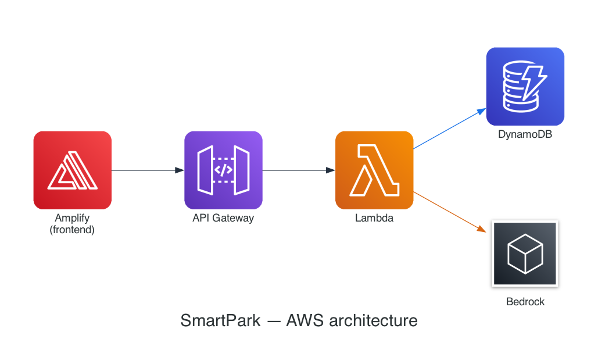

# SmartPark

SmartPark helps university commuter students pick one parking lot for their next class. It only considers lots their permit allows, weighs predicted availability against walking time, and tells them when to arrive at the lot.

> **Data note:** Parking availability in SmartPark is a prediction from a simulated prototype dataset (see [data/README.md](data/README.md)). It is not live or real-time, it is not measured campus data, and SmartPark does not track individual spots. The input and results screens always show this disclaimer, and every successful API response includes `"simulated_data": true`. The steering docs describe the data as "simulated/historical"; the current dataset is entirely simulated.

**Live app:** <https://main.d2mh5kfdhenw0s.amplifyapp.com>

**Demo video:** _not recorded yet._

## Contents

1. [Project overview](#1-project-overview)
2. [Architecture and technical documentation](#2-architecture-and-technical-documentation)
3. [Design decisions](#3-design-decisions)
4. [Kiro usage](#4-kiro-usage): [spec-driven development](#spec-driven-development), [steering docs](#steering-docs), [vibe coding](#vibe-coding), [agent hooks](#agent-hooks), [MCP](#mcp)
5. [Learning journey and forward thinking](#5-learning-journey-and-forward-thinking)
6. [Getting started](#6-getting-started)
7. [License](#7-license)

## 1. Project overview

### Problem

Commuter students often arrive on campus without knowing which lots are likely to have space. They circle full decks, end up with a long walk to class, or park in a lot their permit doesn't cover.

### Target users

University commuter students who drive to a scheduled class or event and hold a campus parking permit. The prototype uses George Mason University building and lot names so the setting feels real. Every value in the dataset is simulated.

### Solution

The student enters a destination building, a class or event start time, and a permit type. SmartPark then:

1. removes every lot the permit doesn't cover, before any scoring;
2. scores the remaining lots on predicted availability and walking time together, so neither the closest lot nor the emptiest lot wins automatically;
3. returns one recommended lot, up to two alternatives, and a plain-language explanation of the trade-off;
4. tells the student when to arrive at the lot, including time to find a spot.

The ranking is deterministic. Amazon Bedrock only writes the explanation after the lot has been chosen, and a template-based fallback takes over if Bedrock is unavailable.

### Key features

| Feature | Implemented in |
|---|---|
| Form for building, time, and permit, with a message naming any missing field | [InputForm.tsx](frontend/src/components/InputForm.tsx) |
| Permit eligibility hard filter | [eligibility.py](backend/recommendation/eligibility.py) |
| Availability looked up at each lot's own arrival time, not the class start time | [handler.py](backend/handler.py), [arrival_time.py](backend/recommendation/arrival_time.py) |
| Deterministic score that balances availability and walking time | [scoring.py](backend/recommendation/scoring.py) |
| One recommendation, up to two alternatives, and an "Arrive by" time | [RecommendationResult.tsx](frontend/src/components/RecommendationResult.tsx) |
| Bedrock explanation with a deterministic fallback | [bedrock_client.py](backend/shared/bedrock_client.py), [fallback_explainer.py](backend/shared/fallback_explainer.py) |
| Separate screens for "no lots for this permit" (404), "no data for this time" (422), and other errors | [api.ts](frontend/src/utils/api.ts), [ErrorState.tsx](frontend/src/components/ErrorState.tsx) |
| Non-dismissible simulated-data disclaimer | [DisclaimerBanner.tsx](frontend/src/components/DisclaimerBanner.tsx) |
| Mobile-friendly layout: a centered column up to 560 px wide, two-column rows that collapse to one column at 400 px wide or less (form) and 360 px or less (results), and form controls at least 46 px tall | [App.css](frontend/src/App.css), [index.css](frontend/src/index.css) |

## 2. Architecture and technical documentation



The same architecture as a simplified AWS icon diagram, generated from [infra/template.yaml](infra/template.yaml) with the `generate_diagram.py` script in [docs/architecture/](docs/architecture/) (the `diagrams` Python package, rendered with Graphviz). The full request flow, including the Bedrock fallback, is in the Mermaid diagram above; this version is meant to be readable at a glance:



All backend resources are defined in [infra/template.yaml](infra/template.yaml) (AWS SAM). The frontend is a static Vite build served by AWS Amplify Hosting.

### Request flow

[handler.py](backend/handler.py) runs these steps for each `POST /recommend`:

1. Parse the JSON body and require `building_id`, `start_time`, and `permit_type`. On failure: 400 `validation_error`.
2. Load the building. Unknown ID: 400 `building_not_found`.
3. Load all lots (one DynamoDB Scan).
4. Apply the permit hard filter. No lots left: 404 `no_eligible_lots`.
5. For each eligible lot, read its walking time, compute its arrival time, and read predicted availability for that arrival weekday and hour. Lots with no data for that slot are skipped, never scored as 0%. If every lot is skipped: 422 `no_availability_data`.
6. Score and rank. The top lot wins and the next two become alternatives.
7. Ask Bedrock for an explanation. Any Bedrock failure falls back to the deterministic explainer.
8. Return 200 with the recommendation and alternatives.

Anything unexpected returns 500 `internal_error`. The exception type and message go to CloudWatch Logs only.

### API contract

`POST /recommend` on the API Gateway stage `prod`. The full URL is the `ApiUrl` stack output, for example `https://<api-id>.execute-api.us-east-1.amazonaws.com/prod/recommend`. The frontend client and its TypeScript types live in [frontend/src/utils/api.ts](frontend/src/utils/api.ts).

Request body (JSON object):

| Field | Type | Rules |
|---|---|---|
| `building_id` | string | Required, non-empty, must match a seeded building (for example `bldg_enterprise`, `bldg_johnson`, `bldg_exploratory`) |
| `start_time` | string | Required. Full ISO 8601 datetime: `YYYY-MM-DDTHH:MM:SS` or `YYYY-MM-DDTHH:MM`, using the student's local date and time (no timezone conversion) |
| `permit_type` | string | Required, non-empty. Seeded values: `GENERAL`, `FACULTY_STAFF`. An unknown value matches no lots (404) |

The frontend combines a native date input and a native time input into a single `YYYY-MM-DDTHH:MM:SS` string and sends it verbatim, with no timezone conversion.

Example request:

```json
{
  "building_id": "bldg_exploratory",
  "start_time": "2025-09-15T10:30:00",
  "permit_type": "GENERAL"
}
```

Response (200). This body came from running `handler.lambda_handler` locally against the seed data with DynamoDB and Bedrock stubbed (reformatted here), so the explanation is the fallback text. With Bedrock enabled, only `explanation` changes.

```json
{
  "recommendation": {
    "lot_name": "Lot K",
    "availability_percentage": 60,
    "walking_time_minutes": 6.0,
    "permit_eligible": true,
    "arrival_time": "10:19 AM",
    "explanation": "Lot K is recommended because it has moderate predicted availability and is a 6-minute walk from your destination. Compared to nearby alternatives, it offers the best balance of availability and walking distance.",
    "simulated_data": true
  },
  "alternatives": [
    { "lot_name": "Shenandoah Parking Deck", "availability_percentage": 20, "walking_time_minutes": 4.0, "permit_eligible": true },
    { "lot_name": "Rappahannock Parking Deck", "availability_percentage": 35, "walking_time_minutes": 9.0, "permit_eligible": true }
  ]
}
```

- `alternatives` holds zero to two runner-ups in rank order.
- `permit_eligible` is always `true`, because only eligible lots are scored.
- The internal composite score is never returned.

Errors share one shape, `{"error": "<code>", "message": "<text>"}`, and validation errors add a `fields` list.

| Status | `error` | When | Frontend screen |
|---|---|---|---|
| 400 | `validation_error` | Body isn't a JSON object, a field is missing or empty, or `start_time` doesn't parse | "Something went wrong" |
| 400 | `building_not_found` | `building_id` isn't in the table | "Something went wrong" |
| 404 | `no_eligible_lots` | The permit matches no lot | "No lots available", plus a prompt to check the permit |
| 422 | `no_availability_data` | Eligible lots exist, but none has data at its arrival time | "Try a different time" |
| 500 | `internal_error` | Anything unexpected | "Something went wrong" |

Every Lambda response sets `Content-Type: application/json` and `Access-Control-Allow-Origin` (from the `CORS_ALLOW_ORIGIN` environment variable, default `*`).

### Data model

One DynamoDB table, `smartpark`, with on-demand billing and string keys `PK` (partition) and `SK` (sort). It's defined in [infra/template.yaml](infra/template.yaml), written by [data/seed_dynamo.py](data/seed_dynamo.py), and read only through [backend/shared/db_client.py](backend/shared/db_client.py).

| Item | `PK` | `SK` | Attributes | Seeded |
|---|---|---|---|---|
| Building | `BUILDING#<building_id>` | `METADATA` | `building_id`, `name` | 3 |
| Permit type | `PERMIT_TYPE#<permit_type>` | `METADATA` | `permit_type`, `display_name` | 2 |
| Lot | `LOT#<lot_id>` | `METADATA` | `lot_id`, `name`, `accepted_permit_types` (string set) | 5 |
| Walking time | `WALK#<lot_id>#<building_id>` | `ESTIMATE` | `lot_id`, `building_id`, `walking_time_minutes` | 15 |
| Availability | `LOT#<lot_id>` | `AVAIL#<DAY>#<HH>` | `availability_score` (0 to 100) | 275 (5 lots, Mon to Fri, hours 07 to 17) |

That's 300 items in total; `python3 data/seed_dynamo.py` prints the count without writing anything.

- `db_client.py` uses GetItem for a building, a walking time, and an availability slot, and one filtered Scan for the lot list.
- A missing availability slot returns `None`, which is kept separate from a stored `0`.
- Permit-type items are seeded but not read by the Lambda. The frontend's dropdown options are static in [options.ts](frontend/src/utils/options.ts) and mirror the seed.

### Recommendation algorithm

Everything here is plain Python with no randomness, so the same inputs always produce the same ranking.

1. **Eligibility (hard filter).** `filter_eligible_lots` keeps lots whose `accepted_permit_types` contains the permit. An empty result raises `NoEligibleLotsError` (404), and nothing ineligible reaches scoring.
2. **Arrival time per lot.** `arrival = start_time - walking_time_minutes - PARKING_BUFFER_MINUTES`, with the buffer defaulting to 5 minutes. Availability is read for that lot's arrival weekday and hour, so a lot with a long walk can be checked at an earlier hour.
3. **Score.** From [scoring.py](backend/recommendation/scoring.py):

   ```text
   score = availability_percentage - WALK_PENALTY * walking_time_minutes
   if availability_percentage < LOW_AVAIL_THRESHOLD:
       score -= LOW_AVAIL_PENALTY

   WALK_PENALTY = 6, LOW_AVAIL_THRESHOLD = 40, LOW_AVAIL_PENALTY = 20
   ```

   Lots sort by score (highest first), and ties go to the shorter walk. The first lot wins and the next two become alternatives.
4. **Explain.** Bedrock receives the finished result and writes two or three sentences. If it fails, [fallback_explainer.py](backend/shared/fallback_explainer.py) describes availability as high (75% or more), moderate (45% or more), or low, and states the walk.
5. **Respond.** `arrival_time` is the winner's own arrival time, formatted like `10:19 AM`.

Worked example from the seed data: a Monday class at Exploratory Hall with a General permit. Lot A is filtered out because it only accepts Faculty/Staff.

| Lot | Walk | 10:30 AM class: availability, score | 2:30 PM class: availability, score |
|---|---|---|---|
| Lot K | 6 min | 60%, **24 (wins)** | 76%, 40 |
| Shenandoah Parking Deck | 4 min | 20%, -24 | 75%, **51 (wins)** |
| Rappahannock Parking Deck | 9 min | 35%, -39 | 70%, 16 |
| Mason Pond Parking Deck | 10 min | 28%, -52 | 68%, 8 |

At 10:30, Shenandoah is two minutes closer, but at 20% predicted availability it scores well below Lot K even before the extra low-availability deduction. By 2:30 the deck has recovered and its shorter walk wins. That's the rule from [product.md](.kiro/steering/product.md): neither factor decides the winner on its own.

### Repository structure

```text
smartpark/
├── .kiro/
│   ├── hooks/                      # Agent hooks (added during submission prep)
│   │   ├── backend-tests-on-save.json
│   │   ├── confirm-aws-changes.json
│   │   └── data-honesty-review.json
│   ├── settings/
│   │   └── mcp.json                # Project MCP servers (added during submission prep)
│   ├── specs/smartpark-mvp/        # requirements.md, design.md, tasks.md, .config.kiro
│   └── steering/                   # product.md, tech.md, structure.md
├── backend/                        # Lambda source (SAM CodeUri)
│   ├── handler.py                  # Entry point: validation and pipeline
│   ├── recommendation/             # eligibility.py, scoring.py, arrival_time.py (no I/O)
│   ├── shared/                     # db_client.py, bedrock_client.py, fallback_explainer.py, models.py, exceptions.py
│   ├── tests/                      # pytest suite with AWS mocked (17 tests)
│   ├── pyproject.toml              # pytest configuration
│   ├── requirements.txt            # Lambda runtime dependency: boto3
│   └── requirements-dev.txt        # Test dependencies (added during submission prep)
├── data/
│   ├── README.md                   # Dataset description (simulated)
│   └── seed_dynamo.py              # Builds the seed items; writes them only with --write
├── frontend/                       # React + TypeScript + Vite
│   ├── public/favicon.svg
│   ├── src/
│   │   ├── components/             # InputForm, RecommendationResult, ErrorState, DisclaimerBanner, icons
│   │   ├── utils/                  # api.ts (client and types), options.ts (dropdown options)
│   │   ├── test/setup.ts           # Vitest setup (no test files yet)
│   │   ├── App.tsx, main.tsx       # View state (idle, loading, success, error) and entry point
│   │   └── App.css, index.css, vite-env.d.ts
│   ├── .env.example                # VITE_API_URL template
│   └── index.html, package.json, package-lock.json, vite.config.ts, tsconfig*.json, .eslintrc.cjs, .gitignore
├── infra/template.yaml             # SAM template: DynamoDB table, Lambda, API Gateway
├── samconfig.toml                  # SAM deploy settings: stack smartpark, us-east-1
├── .gitignore
└── README.md
```

## 3. Design decisions

### Technology choices

| Area | Choice | Alternatives | Why this choice |
|---|---|---|---|
| Frontend | React 18, TypeScript, Vite 5, plain CSS | Next.js, a CSS framework | One screen with four view states and no routing or server rendering. Types in `api.ts` mirror the API. The production build is about 154 kB of JS and 11 kB of CSS before compression |
| Hosting | AWS Amplify Hosting | S3 plus CloudFront, Vercel or Netlify | Git-connected builds and HTTPS for a static `dist/` folder, with no bucket or distribution to manage, and hosting stays on AWS with the backend |
| API | API Gateway REST API | HTTP API, Lambda function URL | SAM's `Cors` setting handles preflight. REST APIs support usage plans, API keys, and AWS WAF for later hardening |
| Compute | One Python 3.12 Lambda | Several Lambdas, containers on ECS or Fargate | There's one request type. Python modules keep the logic separately testable without extra deploy units. [tech.md](.kiro/steering/tech.md) rules out containers and long-running servers |
| Data | DynamoDB, single table, on-demand | Aurora or RDS, JSON bundled with the Lambda | Every read is a key lookup on a small dataset. On-demand billing means no capacity to manage, and unlike bundled JSON the data can be re-seeded without a redeploy |
| Ranking | Fixed formula with named constants | A trained ML model, letting an LLM rank lots | Explainable and unit-testable, and there's no real data to train on. tech.md requires deterministic, explainable logic |
| Explanations | Bedrock Converse API with Claude Haiku 4.5, plus a template fallback | Template text only | Friendlier wording for the trade-off. Haiku is the small, fast Claude tier and output is capped at 300 tokens. The fallback means Bedrock is never required |
| Infrastructure as code | AWS SAM | AWS CDK, Terraform, console setup | A short template for a serverless stack, with `sam build`, `sam deploy`, and `sam local` in one CLI |

### Trade-offs

**Cost vs. performance**

- Everything bills per use: Lambda per invocation, API Gateway per request, DynamoDB per request plus storage, Bedrock per token. Nothing runs while idle. The flip side is a cold start on the first request after a quiet period (not measured).
- DynamoDB on-demand needs no capacity planning. Provisioned capacity would only be cheaper per request at steady, predictable load.
- Each recommendation makes one Bedrock call, which adds latency and per-token cost. The small model and the 300-token output cap keep that bounded. If Bedrock is slow to fail, though, the request waits (see [Scalability](#scalability)).
- The Lambda runs with 256 MB and a 15-second timeout, sized for a Bedrock round trip.

**Simplicity vs. features**

- One endpoint, one Lambda, one table. No accounts, saved schedules, or admin screens.
- Dropdown options are static in `options.ts` instead of coming from an API. That saves an endpoint, but the list has to be updated by hand when the seed changes.
- The scoring constants (6, 40, 20) are hand-picked; scoring.py calls them "configurable prototype parameters". They are easy to explain and test, but they aren't fitted to real outcomes.
- Bedrock only explains. Students get readable wording, and an outage changes the wording, never the lot. The cost is that explanation style varies depending on which path ran.
- Simulated data keeps the prototype honest and self-contained, with no data-sharing agreement needed. It says nothing about real conditions, and it only covers weekdays from 7 AM to 5 PM.
- A single function means one IAM role holds both DynamoDB read and Bedrock invoke permissions.
- The fixed table name `smartpark` keeps the seed script's default simple, but allows one stack per account and region.
- `CodeUri: ../backend/` is simple, but it also ships `backend/tests/` (about 20 KB, never imported at runtime).

### Security

- **No authentication, by design.** Accounts and login are out of scope for the MVP ([product.md](.kiro/steering/product.md)), so `POST /recommend` is a public, unauthenticated endpoint. It reads simulated parking data and stores nothing.
- **Least-privilege IAM.** The Lambda role has SAM's `DynamoDBReadPolicy` on the `smartpark` table only (GetItem, Scan, Query, BatchGetItem, DescribeTable, and no writes), plus `bedrock:InvokeModel` and `bedrock:InvokeModelWithResponseStream` on the Claude Haiku 4.5 inference profile and the three foundation-model ARNs it routes to. Neither statement uses a wildcard resource. SAM also attaches the standard basic execution policy for CloudWatch Logs.
- **CORS.** The `CorsAllowOrigin` parameter drives both the API Gateway preflight and the header `handler.py` adds. It defaults to `*`, and `samconfig.toml` keeps `*`. For production, set it to the Amplify origin.
- **Throttling.** `template.yaml` configures no stage throttling, usage plan, or WAF, so only API Gateway's account-level defaults apply. Before wider use, add stage rate and burst limits, a usage plan, and an AWS WAF rate-based rule.
- **Input validation.** `handler.py` requires a JSON object with three non-empty strings and a parseable `start_time`, and the building must exist. Values are only used as DynamoDB key parts or set lookups, never in a query language. There are no length limits. Error messages echo the submitted `building_id` or `permit_type`, and React renders them as text.
- **What goes into the Bedrock prompt.** The prompt is built from server-side values only: the building name from DynamoDB, the parsed start time, and the chosen and runner-up lots' names, availability percentages, and walking times. No raw user text and no internal score are included. The prompt says the data is simulated and not live, and tells the model not to invent facts.
- **No PII.** There are no accounts and requests aren't stored. The Lambda only logs unhandled exceptions (type and message) to CloudWatch Logs.
- **No secrets in the repo.** `VITE_API_URL` is a public URL. `.env` files are gitignored except `.env.example`, and a secret scan during submission prep found no keys, tokens, or account IDs.
- **Configuration errors fail loudly.** A missing `BEDROCK_MODEL_ID` is treated as a configuration error (500), not a Bedrock outage. `template.yaml` always sets it.

### Scalability

- **Lambda** adds instances as concurrent requests grow. A successful recommendation makes 2 + 2 × (eligible lots) DynamoDB reads, which is 10 for either seeded permit, plus one Bedrock call.
- **DynamoDB on-demand** grows with traffic without capacity changes.
- **Bedrock** is the slowest and most quota-limited step. The US cross-region inference profile can route requests to us-east-1, us-east-2, or us-west-2. When Bedrock throttles or errors, the fallback still returns a 200 with the same ranking, so Bedrock limits affect explanation wording, not whether students get an answer.
- **Known limits at higher load:** a full-table Scan on every request (a single page with no pagination, so lots past DynamoDB's 1 MB page limit would be missed), sequential per-lot reads, a new Bedrock client on every call, and boto3's default 60-second timeouts, which are longer than the 15-second Lambda timeout. A hung Bedrock call would time out the Lambda before the fallback runs. Fixes are listed under [Future enhancements and scaling plans](#future-enhancements-and-scaling-plans).

## 4. Kiro usage

### Where to look

| Kiro feature | Files | Notes |
|---|---|---|
| Steering | [product.md](.kiro/steering/product.md), [tech.md](.kiro/steering/tech.md), [structure.md](.kiro/steering/structure.md) | Committed with the MVP in `b03ac24`. tech.md and structure.md were updated during submission prep |
| Spec | [requirements.md](.kiro/specs/smartpark-mvp/requirements.md), [design.md](.kiro/specs/smartpark-mvp/design.md), [tasks.md](.kiro/specs/smartpark-mvp/tasks.md), [.config.kiro](.kiro/specs/smartpark-mvp/.config.kiro) | Requirements-first feature spec, committed with the MVP in `b03ac24` |
| Agent hooks | [backend-tests-on-save.json](.kiro/hooks/backend-tests-on-save.json), [data-honesty-review.json](.kiro/hooks/data-honesty-review.json), [confirm-aws-changes.json](.kiro/hooks/confirm-aws-changes.json) | Added during submission prep |
| MCP | [.kiro/settings/mcp.json](.kiro/settings/mcp.json) | Added during submission prep; not used during the build |

### Spec-driven development

The MVP has one Kiro spec, `smartpark-mvp`. Its `.config.kiro` records `"workflowType": "requirements-first"` and `"specType": "feature"`, so it went from requirements to design to tasks.

- **[requirements.md](.kiro/specs/smartpark-mvp/requirements.md)** has an 18-term glossary (Recommendation_Engine, Eligibility_Filter, Fallback_Explainer, and so on) and 9 requirements with 39 acceptance criteria in EARS style (`WHEN`, `IF ... THEN`, `WHERE`, `THE ... SHALL`). For example, 2.1: "WHEN the Recommendation_Engine receives a request, THE Recommendation_Engine SHALL apply the Eligibility_Filter as the first step before any scoring is performed."
- **[design.md](.kiro/specs/smartpark-mvp/design.md)** covers the architecture, component and module contracts, the single-table data model and access patterns, the API contract, the Bedrock prompt and fallback, error handling, the testing strategy, and 9 correctness properties written for property-based testing. Each property names the requirements it validates.
- **[tasks.md](.kiro/specs/smartpark-mvp/tasks.md)** has 19 top-level tasks. Every sub-task is tagged with the requirements it covers (`_Requirements: 2.1, 2.2_`), optional test tasks are marked `*`, there are four checkpoints, and a dependency graph groups the tasks into 12 waves.

**Task status.** 6 of 19 top-level tasks and 21 of 63 checkboxes are ticked, but the boxes lag the code. Tasks 9.2, 13.1, 13.2, 14.1, 15.1, 16.1, and 16.2 are implemented but unticked: the per-lot handler pipeline, the frontend components, and the responsive CSS. Besides the four checkpoints, two required tasks are still open: 8.2 (dedicated `fallback_explainer.py` unit tests; the fallback is only covered through handler tests) and 18.1 (integration tests against a running API). All 20 optional `*` tasks are unticked. Existing tests partly cover 3.2, 8.4, and 9.4, but none of the Hypothesis property tests (4.2, 5.2 to 5.6, 6.2, 6.3, 9.3) were written; `hypothesis` stays in `requirements-dev.txt` for them.

**Traceability**

| Requirement | Design element | Code | Tests |
|---|---|---|---|
| 1. Input form | `InputForm` | [InputForm.tsx](frontend/src/components/InputForm.tsx), [options.ts](frontend/src/utils/options.ts) | None (no frontend tests yet) |
| 2. Permit filter | `eligibility.py`, `NoEligibleLotsError` to 404 | [eligibility.py](backend/recommendation/eligibility.py), [handler.py](backend/handler.py) step 4 | `test_no_eligible_lots_still_returns_404` in [test_handler_missing_availability.py](backend/tests/test_handler_missing_availability.py) |
| 3. Scoring | Composite_Score formula and tiebreaker | [scoring.py](backend/recommendation/scoring.py) | Winner and order in [test_handler_response_shape.py](backend/tests/test_handler_response_shape.py); identical ranking with or without Bedrock in [test_bedrock_integration.py](backend/tests/test_bedrock_integration.py) |
| 4. Arrival time | Arrival_Time calculation, `PARKING_BUFFER_MINUTES` | [arrival_time.py](backend/recommendation/arrival_time.py), [RecommendationResult.tsx](frontend/src/components/RecommendationResult.tsx) | Presence only (`test_recommendation_object_fields`); no exact-time test |
| 5. Explanation | Bedrock integration and fallback path | [bedrock_client.py](backend/shared/bedrock_client.py), [fallback_explainer.py](backend/shared/fallback_explainer.py) | [test_bedrock_integration.py](backend/tests/test_bedrock_integration.py) (5 tests), `test_fallback_explanation_preserves_response_shape` |
| 6. Display | `RecommendationResult`, `ErrorState`, `DisclaimerBanner` | [RecommendationResult.tsx](frontend/src/components/RecommendationResult.tsx), [ErrorState.tsx](frontend/src/components/ErrorState.tsx), [DisclaimerBanner.tsx](frontend/src/components/DisclaimerBanner.tsx) | None |
| 7. Responsive layout | `App` and responsive CSS | [App.tsx](frontend/src/App.tsx), [App.css](frontend/src/App.css), [index.css](frontend/src/index.css) | None |
| 8. Data and seeding | Single-table design | [template.yaml](infra/template.yaml), [seed_dynamo.py](data/seed_dynamo.py), [db_client.py](backend/shared/db_client.py) | [test_db_client_availability.py](backend/tests/test_db_client_availability.py) (3 tests) |
| 9. API contract | API contract and error table | [handler.py](backend/handler.py), [api.ts](frontend/src/utils/api.ts), [template.yaml](infra/template.yaml) | 200 shape in [test_handler_response_shape.py](backend/tests/test_handler_response_shape.py); 404 and 422 in [test_handler_missing_availability.py](backend/tests/test_handler_missing_availability.py); no 400 or 500 tests |

**Where the code differs from the spec**

| Spec | Code | Where |
|---|---|---|
| design.md: `WALK_PENALTY = 10`, no low-availability penalty | `WALK_PENALTY = 6`, plus -20 below 40% availability. tasks.md 5.1 matches the code; design.md wasn't updated | [scoring.py](backend/recommendation/scoring.py) |
| design.md: a flat response `{lot_name, arrival_time, explanation, simulated_data}` | A nested `recommendation` object (Req 9.2's fields plus availability, walk, and permit) and an `alternatives` list | [handler.py](backend/handler.py), [api.ts](frontend/src/utils/api.ts) |
| No "no data for this time" case | 422 `no_availability_data` and a "Try a different time" screen (commit `6ab0839`) | [handler.py](backend/handler.py), [ErrorState.tsx](frontend/src/components/ErrorState.tsx) |
| design.md: Bedrock `invoke_model` | Bedrock Converse API (`converse`) | [bedrock_client.py](backend/shared/bedrock_client.py) |
| Tasks 3.1 and 8.3: fail at module load when env vars are missing | Checked on first use, so modules import cleanly in tests | [db_client.py](backend/shared/db_client.py), [bedrock_client.py](backend/shared/bedrock_client.py) |
| design.md: availability for every day, hours 07 to 21. Task 12.1: Mon to Fri, 07 to 21, in `scripts/seed_dynamodb.py` | Mon to Fri, hours 07 to 17, in `data/seed_dynamo.py` | [seed_dynamo.py](data/seed_dynamo.py) |
| Req 8.1: lots and buildings store coordinates | No coordinates. Walking times are precomputed per lot and building pair, which design.md chose | [seed_dynamo.py](data/seed_dynamo.py) |
| design.md: a time-only input uses the date in the campus time zone | Removed: the frontend now always sends a full local `YYYY-MM-DDTHH:MM:SS` datetime, and the handler no longer accepts a bare time-only value, so this divergence no longer applies | [handler.py](backend/handler.py), [InputForm.tsx](frontend/src/components/InputForm.tsx) |
| Req 4.4 and 6.2: exact wording | "Arrive by ... to make it to class on time, including time to find a spot" and "Availability estimates are simulated for this prototype and are not live parking data." | [RecommendationResult.tsx](frontend/src/components/RecommendationResult.tsx), [DisclaimerBanner.tsx](frontend/src/components/DisclaimerBanner.tsx) |

**Spec-driven vs. vibe coding, from the repo's evidence**

- Every module design.md lists exists under the same name (`handler.py`, `recommendation/{eligibility,scoring,arrival_time}.py`, `shared/{db_client,bedrock_client,fallback_explainer}.py`, and the five frontend components), and the error-to-status mapping follows design.md's error table. The spec set the structure.
- The spec hasn't changed since `b03ac24` (`git log -- .kiro/specs` lists only that commit). The later commits `6ab0839` and `80248c3` changed behavior and UI without touching it, which accounts for part of the drift above.

Writing requirements first forced the MVP boundaries to exist before any code did: destination building, class/event time, and permit type as the only inputs; permit eligibility as a hard filter that runs before scoring; a deterministic score instead of a model; one recommended lot with an arrival time; and the simulated-data disclaimer as a requirement, not an afterthought. That gave the project its shape and kept Kiro's generated code aligned with that shape from the first implementation task onward.

Vibe coding was faster for the smaller decisions that only became visible once the app was running, not while writing requirements. Splitting "no data for this time" out of the generic "no eligible lots" 404 (`6ab0839`) is the clearest example: the spec didn't anticipate that distinction, and it came out of testing the handler with gaps in the seeded hours, then describing the problem to Kiro and iterating on the fix.

Next time, I'd keep the spec synchronized as these implementation decisions land, instead of letting `tasks.md` and `design.md` drift the way they have here (see the traceability notes above). A short "update the spec" step after a vibe-coding fix would have kept `design.md`'s walk penalty and response shape, and `tasks.md`'s checkboxes, matching the code.

### Steering docs

There are three steering files. None has front-matter, so Kiro includes all three in every interaction (the default "always" inclusion).

| File | Covers |
|---|---|
| [product.md](.kiro/steering/product.md) | Problem, how it works, MVP scope with an explicit out-of-scope list, Data Honesty, Recommendation Logic |
| [tech.md](.kiro/steering/tech.md) | Stack, architecture sketch, six Key Design Constraints, common commands |
| [structure.md](.kiro/steering/structure.md) | Repository layout and conventions |

**Rules and where they show up in code**

| Steering rule | Evidence |
|---|---|
| tech.md: "If Bedrock is unavailable, SmartPark must still return the recommendation using a deterministic fallback explanation" | [handler.py](backend/handler.py) catches `BedrockUnavailableError` and calls [fallback_explainer.py](backend/shared/fallback_explainer.py). [test_bedrock_integration.py](backend/tests/test_bedrock_integration.py) checks for a 200 across three failure types |
| tech.md: "Amazon Bedrock may explain a completed recommendation but must not determine parking eligibility or choose the winning lot" | Bedrock is called after scoring (handler step 7) with the chosen lot. `test_recommendation_identical_whether_bedrock_succeeds_or_fails` |
| product.md, Data Honesty: "Do not present availability as live or real-time. Do not claim individual spot availability." | [DisclaimerBanner.tsx](frontend/src/components/DisclaimerBanner.tsx), the "Predicted availability" label, `simulated_data: true`, and a Bedrock prompt that calls the data "simulated prototype data, not live or real-time information" |
| tech.md: "Permit eligibility is a hard filter applied before scoring" | [eligibility.py](backend/recommendation/eligibility.py): "This is a hard filter: ineligible lots are excluded entirely before any scoring takes place." It runs at handler step 4, before scoring |
| product.md: "a lot 30 seconds closer that is almost always full should lose to a lot 3 minutes away that is reliably available" | The score in [scoring.py](backend/recommendation/scoring.py) trades 6 points per walking minute against availability and deducts 20 more below 40%. See the [worked example](#recommendation-algorithm) |
| tech.md: "All backend infrastructure is serverless" | [template.yaml](infra/template.yaml) contains only Lambda, API Gateway, and DynamoDB |
| structure.md: "Seed/mock data lives in `data/` and is clearly labeled as simulated" | [data/README.md](data/README.md) and the `seed_dynamo.py` docstring |

What the repo shows about how steering helped: the rules reappear almost word for word in docstrings and comments. For example, `bedrock_client.py` says Bedrock "never selects or changes the recommendation." The Key Design Constraints are short, testable "must" statements, and each one maps to specific code or a test.

tech.md and structure.md were updated during this submission-prep workflow. tech.md's Common Commands table held only "TBD" entries and now lists the verified local commands, with deploy commands marked as not executed. structure.md's "early setup / Planned Layout" placeholder now shows the real layout after cleanup, including `.kiro/hooks/` and `.kiro/settings/mcp.json`. product.md and tech.md's Key Design Constraints are unchanged.

Steering kept Kiro aligned with the core architecture and product rules without needing to restate them in every prompt: permit eligibility always runs before scoring, the recommendation logic stays deterministic and explainable, simulated data is never described as live, Bedrock may explain a result but never picks the lot or decides eligibility, and the app has to keep working if Bedrock fails. Having those rules live in `tech.md` and `product.md` meant each new prompt could focus on the task at hand instead of re-establishing the ground rules.

The short, explicit "must" constraints in `tech.md` (Key Design Constraints) and the out-of-scope list in `product.md` were the most useful parts. Both are easy to point back to when checking whether a change still fits the project, and they're specific enough that the evidence table above could map each one to actual code or a test.

### Vibe coding

No chat transcripts are stored in the repo, so specific prompts can't be shown here. Git history shows the following:

- `b03ac24` "Build SmartPark MVP" (55 files) adds the spec, the steering, and the full implementation.
- `6ab0839` "Improve unavailable time handling" separates "no data for this time" from "no eligible lots": a new `NoAvailabilityDataError`, a 422 response, a third frontend error screen, and updated tests. Before it, the handler reused the 404 path for missing data.
- `80248c3` "Update SmartPark browser title" replaces the Vite template title ("Vite + React + TS") in `index.html` with "SmartPark".

This final submission pass was run from a Kiro chat session that launched a multi-step Kiro workflow: investigate and record a baseline, clean up and re-verify, write the docs, hooks, and MCP config, run a review loop, and produce a final report. The cleanup removed unused Vite template files (`frontend/README.md`, `vite.svg`, `react.svg`), added a SmartPark favicon, moved test-only dependencies out of the Lambda bundle into `requirements-dev.txt`, and tidied `.gitignore`. Each change was checked against the baseline: 17 backend tests passing, the frontend build, and lint.

I worked with Kiro in focused rounds: give it one concrete task, review the diff, run the tests, try the behavior, then move to the next issue, rather than asking it to redesign the whole project in one pass.

Two moments stood out:

- **Separating missing data from 0% availability (`6ab0839`).** After testing the handler against times outside the seeded hours, it was clear that treating "no data" the same as "0% availability" was misleading: one is a real prediction, the other means SmartPark doesn't know. Working through this with Kiro led to a dedicated `NoAvailabilityDataError`, a 422 response, and a third frontend error screen ("Try a different time"), instead of overloading the existing 404.
- **Adding Amazon Bedrock as an explanation-only layer.** The deterministic ranking had to stay untouched, so the task was to call Bedrock's Converse API after the lot was already chosen, scope the IAM policy to the specific inference profile and foundation-model ARNs instead of a wildcard, and add mocked tests for both a successful call and each failure path, confirming the ranking comes out identical either way (`backend/shared/bedrock_client.py`, `infra/template.yaml`, `backend/tests/test_bedrock_integration.py`).

The final submission pass was its own round of this same process, just run through a multi-step Kiro workflow instead of one chat: it cleaned up the repository, generated this documentation, added the three hardening hooks and the MCP configuration described below, and ran a review loop to check the result.

### Agent hooks

Three hooks live in `.kiro/hooks/`, using Kiro's standalone hook-file format (`"version": "v1"`). They were added during this final submission-prep pass, not during the original feature work.

| Hook | Trigger | Matcher | Action | File |
|---|---|---|---|---|
| Run backend tests on save | `PostFileSave` | `backend/.*\.py$` | Command: `cd backend && .venv/bin/python -m pytest -q` | [backend-tests-on-save.json](.kiro/hooks/backend-tests-on-save.json) |
| Data honesty copy review | `PostFileSave` | `frontend/src/(components/.*\|App)\.tsx$` | Agent prompt: review the saved file's user-facing copy against product.md's Data Honesty section, flag wording that presents availability as live, real-time, or per-spot, and suggest a fix | [data-honesty-review.json](.kiro/hooks/data-honesty-review.json) |
| Confirm before changing AWS resources | `PreToolUse` | `^(execute_bash\|control_bash_process)$` | Command: a `python3 -c` one-liner that returns a `permissionDecision: "ask"` payload when a shell command contains `sam deploy`, `sam delete`, `sam sync`, or `aws dynamodb delete-table` | [confirm-aws-changes.json](.kiro/hooks/confirm-aws-changes.json) |

Why these three:

- The test hook catches pipeline regressions as soon as a backend file changes. The suite takes under a second and makes no AWS calls.
- The data-honesty review turns the most important product rule into an automatic check where it's most likely to break: UI copy.
- The confirmation gate puts a person in the loop before anything that changes or deletes the live stack or table.

All three files parse as JSON, and the test command passes (17 tests). The confirm hook's one-liner was tested by piping in sample tool events. It printed the `ask` payload for each of the four phrases and nothing for other commands, empty input, or non-JSON input, exiting 0 every time. The files also match the hook schema in the installed Kiro IDE (1.2.56). That version tests each matcher as a regular expression against the saved file's path or the tool name (`execute_bash` and `control_bash_process` are its shell tools), runs command hooks from the workspace root, and asks you to confirm when a `PreToolUse` hook prints the `ask` decision. Kiro reads hook files when a session starts, and these hooks haven't fired inside a live Kiro session yet (see the [Kiro hooks docs](https://kiro.dev/docs/hooks/)).

To be explicit: these three hooks were added during final submission hardening, not throughout the original build. They weren't part of the development process that produced the application code above; they exist to catch regressions and policy violations in whatever comes next. Their intended purpose: automatically run the backend test suite after a Python file changes, review frontend copy for data-honesty violations after a component changes, and require a human to confirm before any command that changes or deletes live AWS resources.

### MCP

[.kiro/settings/mcp.json](.kiro/settings/mcp.json) configures two AWS Labs MCP servers for this workspace:

| Server | Package | What it adds |
|---|---|---|
| `aws-documentation` | `awslabs.aws-documentation-mcp-server@latest` | Searching and reading AWS documentation from chat |
| `aws-serverless` | `awslabs.aws-serverless-mcp-server@latest` | SAM and Lambda guidance and tooling. It runs read-only by default, and this config doesn't pass `--allow-write` or `--allow-sensitive-data-access` |

Both start through `uvx` with `FASTMCP_LOG_LEVEL=ERROR`, so install `uv` first: <https://docs.astral.sh/uv/getting-started/installation/>. According to its [README](https://github.com/awslabs/mcp/tree/main/src/aws-serverless-mcp-server), the serverless server also needs AWS credentials (it uses the default profile), the SAM CLI, and the AWS CLI.

These servers were **not** used during the original build of SmartPark. They were added during this final submission-prep pass so that later work can check AWS docs and SAM practices without leaving Kiro, for example API Gateway throttling and usage plans, the Bedrock Converse API, or Amplify monorepo settings. Nothing in the current implementation came from them, so the honest answer to "what would have been impossible without MCP" is: nothing yet.

AWS Labs now points to the Agent Toolkit for AWS as the successor to these servers, and says the [awslabs/mcp](https://github.com/awslabs/mcp) repo continues to work.

To be explicit: neither server has been started or used in a live Kiro session yet. This configuration exists for continued work after submission, not for anything already built.

## 5. Learning journey and forward thinking

### Biggest challenges

These are the challenges visible in the code and history.

1. **Missing data is not 0% availability.** Seeded hours run from 07 to 17 on weekdays, and each lot is checked at its own arrival time, so some lots can fall outside the data while others don't. `get_availability` returns `None` for a missing slot and keeps a stored `0` as `0`, and the handler skips lots without data. Commit `6ab0839` then split the all-missing case into its own 422 and a "Try a different time" screen, instead of the misleading 404. Tests: [test_db_client_availability.py](backend/tests/test_db_client_availability.py) (3) and [test_handler_missing_availability.py](backend/tests/test_handler_missing_availability.py) (5).
2. **Keeping Bedrock optional.** Any Converse failure, including an empty reply, becomes `BedrockUnavailableError`, and the handler falls back to deterministic text. [test_bedrock_integration.py](backend/tests/test_bedrock_integration.py) checks three failure types and that the ranking is identical either way. Least-privilege IAM needed care too: the policy names the US inference profile plus the foundation-model ARN in each region the profile routes to, instead of a wildcard.
3. **Lambda packaging.** `backend/requirements.txt` used to list pytest, pytest-mock, and hypothesis. SAM installs that file into the Lambda, and a stale local build confirmed the test tools were in the bundle. During this cleanup, those moved to `backend/requirements-dev.txt`, leaving only boto3 in `requirements.txt`. One gap remains: `CodeUri: ../backend/` still packages `backend/tests/`. A SAM makefile build that copies only `handler.py`, `recommendation/`, and `shared/` would close it.

The hardest of these was the first one: distinguishing "no data" from "0% availability." Early on, both states could be treated almost the same way, but they mean very different things. A 0% prediction is still a valid prediction; missing data means SmartPark simply doesn't know the availability for that lot at that time, and presenting it as 0% would be dishonest about what the system actually knows. Working through this with Kiro led to returning `None` for a missing availability record instead of defaulting it to 0, skipping lots with no data instead of scoring them, a dedicated 422 `no_availability_data` response for the case where every eligible lot is unknown, and a clearer "Try a different time" state on the frontend instead of reusing the generic error screen. It reinforced that getting the code to run isn't the same as getting the data semantics right.

Keeping Bedrock optional was a secondary technical challenge in the same vein: the goal was for AI to improve the quality of the explanation without ever controlling the recommendation, and without becoming a single point of failure if the model is slow, throttled, or returns something unusable.

### What I'd do differently, skills gained, resources

Next time, I'd keep the Kiro spec and tasks synchronized with implementation changes as they happen, instead of letting documentation drift the way `design.md` and `tasks.md` have here. I'd also add frontend tests earlier instead of only scaffolding Vitest, design time-zone handling before it became a known limitation rather than after, and test the deployed AWS path (a real `sam deploy`, a real seeded table, a real Bedrock call) earlier in development instead of relying on mocked tests for the whole build.

Skills gained building this: AWS serverless architecture; AWS SAM and CloudFormation as infrastructure as code; wiring API Gateway to Lambda; DynamoDB key and access-pattern design for a single-table layout; the Amazon Bedrock Converse API and inference profiles; least-privilege IAM policy design; deterministic recommendation-system design (scoring and tie-breaking without a trained model); fallback and error handling for an optional external dependency; and Kiro's spec-driven development, steering, and workflow-based iteration.

Resources that helped: AWS's own service documentation (SAM, API Gateway, DynamoDB, Bedrock), Kiro's documentation and the spec/steering/workflow process itself, and the feedback loop from running tests and builds locally while iterating.

### Known limitations

- A weekend-in-UTC time-only request used to always return 422 regardless of the student's actual local weekday; the frontend now sends a full local date and time, so this no longer happens (see [handler.py](backend/handler.py), [InputForm.tsx](frontend/src/components/InputForm.tsx)).
- Dropdown options are hard-coded in `options.ts` and must be kept in sync with the seed by hand.
- There are no frontend tests, and no backend tests for 400 or 500 responses.
- The Bedrock client uses boto3's default timeouts, which are longer than the Lambda timeout.
- CORS is `*`, and the API has no throttling beyond account defaults.

### Future enhancements and scaling plans

[product.md](.kiro/steering/product.md) lists these features as out of scope for the MVP. This is what each would take on the current architecture:

| Out of scope today | What it would take |
|---|---|
| User accounts, login, profiles | An Amazon Cognito user pool and an API Gateway Cognito authorizer, plus saved class schedules as a new DynamoDB item type |
| Payments or reservations | A payment provider and reservation items created with DynamoDB conditional writes. This moves SmartPark from advice to commitments |
| Premium subscriptions | Builds on accounts. API Gateway usage plans could separate tiers |
| Individual spot tracking | Per-spot sensors and a different data model |
| Live camera feeds or real-time sensor data | An ingestion path that writes recent counts to DynamoDB. The Data Honesty rules and every "predicted" label would need to be revisited at the same time |
| Push notifications | A scheduled job (EventBridge Scheduler and Lambda) that checks the prediction before class and notifies the student, for example through Amazon SNS |

Scaling and hardening plans:

- **Reads:** replace the per-request Scan with a Query on a dedicated lot-list partition or a GSI, and fetch walking times and availability with BatchGetItem, which the IAM policy already allows.
- **Bedrock:** set explicit botocore timeouts and retries below the Lambda timeout, create the client once per container, and cache explanations for repeated inputs, since the ranking is deterministic.
- **Edge:** stage throttling or a usage plan, AWS WAF on the REST API stage, CORS locked to the Amplify origin, and gateway responses with CORS headers so 429 and 5xx errors reach the UI as readable messages.
- **Data:** real historical counts per campus, and a campus prefix in the keys for multiple campuses.
- **Packaging and tests:** the makefile build above, frontend tests with the Vitest setup that's already in place, and the property tests from the spec.

## 6. Getting started

### Prerequisites

| Tool | Version | Needed for |
|---|---|---|
| Node.js and npm | Node 18, or 20 and newer (Vite 5's requirement) | Frontend |
| Python | 3.10 or newer (the code uses `X \| None` type hints). 3.12 matches the Lambda runtime and must be on PATH for `sam build` | Backend tests, seed script, SAM build |
| AWS account and credentials | AWS CLI or environment credentials | Deploying and seeding |
| AWS SAM CLI | Recent version | Build, deploy, teardown |
| Amazon Bedrock access | Anthropic Claude Haiku 4.5 through the US inference profile `us.anthropic.claude-haiku-4-5-20251001-v1:0`, stack region us-east-1 | AI explanations (optional, since the fallback works without it) |
| Docker | Any | Only for `sam local start-api` or `sam build --use-container` |
| uv (`uvx`) | Any | Only for the MCP servers in `.kiro/settings/mcp.json` |

Local checks during submission prep ran on Node 25.2.1, npm 11.6.2, Python 3.10.6, and SAM CLI 1.166.2.

### 1. Deploy the backend

From the repo root:

```bash
sam build -t infra/template.yaml
sam deploy
```

- `sam build` writes `.aws-sam/build/`. It needs `python3.12` on your PATH, or add `--use-container` to build in Docker.
- Run `sam deploy` from the repo root without `-t`. SAM then uses the built template and the root [samconfig.toml](samconfig.toml): stack `smartpark`, region `us-east-1`, `CAPABILITY_IAM`, and a changeset you confirm before it applies. With `-t infra/template.yaml`, SAM would look for `infra/samconfig.toml`, which doesn't exist.
- Use `sam deploy --guided` to change the stack name, region, or parameters. It offers to save your answers back to `samconfig.toml`.

Template parameters (`samconfig.toml` overrides `BedrockModelId`, `ParkingBufferMinutes`, and `CorsAllowOrigin` with the same values):

| Parameter | Default | Purpose |
|---|---|---|
| `BedrockModelId` | `us.anthropic.claude-haiku-4-5-20251001-v1:0` | Inference profile passed to the Converse API |
| `BedrockFoundationModelId` | `anthropic.claude-haiku-4-5-20251001-v1:0` | Scopes the IAM policy. Keep it in sync with `BedrockModelId` |
| `ParkingBufferMinutes` | `5` | Minutes reserved for finding a spot |
| `CorsAllowOrigin` | `*` | Allowed origin. Set it to your Amplify URL for production |

The stack outputs `ApiUrl` (the full `/recommend` URL) and `TableName` (`smartpark`). To print them again: `sam list stack-outputs --stack-name smartpark --region us-east-1`.

If your account can't invoke the Bedrock model, the API still returns recommendations, using the fallback explanation.

None of the deploy commands in this section were run during submission prep. They match `infra/template.yaml` and `samconfig.toml`, and `sam validate --lint` passes on the template.

### 2. Seed DynamoDB

```bash
# Preview: prints the item count and the first 5 items, writes nothing
python3 data/seed_dynamo.py

# Write the 300 simulated items to the deployed table
AWS_DEFAULT_REGION=us-east-1 backend/.venv/bin/python data/seed_dynamo.py --write --table-name smartpark
```

- The dry run works with any Python 3.10+. The write needs boto3, which the backend virtualenv has (see [Run tests and checks](#run-tests-and-checks)).
- Your credentials need `dynamodb:BatchWriteItem` on the table. Re-running overwrites the same keys.
- `--endpoint-url http://localhost:8000` targets DynamoDB Local instead. More detail is in [data/README.md](data/README.md).

Smoke test after seeding (not run during submission prep):

```bash
curl -s -X POST "<ApiUrl>" \
  -H 'Content-Type: application/json' \
  -d '{"building_id":"bldg_exploratory","start_time":"2025-09-15T10:30:00","permit_type":"GENERAL"}'
```

`start_time` must be a full ISO datetime (seconds optional); use any weekday date to see a 200, or a Saturday/Sunday date to see the 422 `no_availability_data` response.

### 3. Run the frontend locally

```bash
# Copy the example only if you don't have a frontend/.env.local yet
[ -f frontend/.env.local ] || cp frontend/.env.example frontend/.env.local
# Edit frontend/.env.local and set VITE_API_URL to the ApiUrl output
cd frontend
npm ci
npm run dev
```

Vite serves the app at <http://localhost:5173> by default. With `CorsAllowOrigin` left at `*`, the deployed API accepts requests from localhost. If `VITE_API_URL` is missing, the app shows "API URL is not configured" when you submit the form.

### Optional: run the API locally

Not run during submission prep, and it needs Docker. SAM local may not resolve `!Ref SmartParkTable` to the deployed table name, so pass the name in an env-vars file:

```json
{ "RecommendationFunction": { "DYNAMODB_TABLE_NAME": "smartpark" } }
```

```bash
sam local start-api -t infra/template.yaml --env-vars env.json
```

The local function calls the real DynamoDB table and Bedrock with your AWS credentials. Point `VITE_API_URL` at `http://127.0.0.1:3000/recommend`.

### 4. Deploy the frontend to Amplify Hosting

The repo has no `amplify.yml`, so set the build up in the Amplify console:

1. Create a new app and connect this repository and branch.
2. Mark it as a monorepo and set the app root to `frontend`. Amplify sets `AMPLIFY_MONOREPO_APP_ROOT=frontend` for you (see [Amplify's monorepo settings](https://docs.aws.amazon.com/amplify/latest/userguide/monorepo-configuration.html)).
3. Build command `npm run build`, output directory `dist`. Make sure the build image's Node version meets Vite 5's requirement.
4. Add the environment variable `VITE_API_URL` with the `ApiUrl` output. Vite inlines it at build time, so redeploy after changing it.
5. After the first deploy, set `CorsAllowOrigin` in `samconfig.toml`'s `parameter_overrides` to the Amplify URL (for example `https://main.<app-id>.amplifyapp.com`) and run `sam deploy` again.

If you prefer a build spec file, this is the equivalent `amplify.yml` for the repo root:

```yaml
version: 1
applications:
  - appRoot: frontend
    frontend:
      phases:
        preBuild:
          commands:
            - npm ci
        build:
          commands:
            - npm run build
      artifacts:
        baseDirectory: dist
        files:
          - '**/*'
      cache:
        paths:
          - node_modules/**/*
```

The app has no client-side routes, so it needs no rewrite rules. None of these Amplify steps were run during submission prep.

### Run tests and checks

Run from the repo root. The results column shows what happened during submission prep.

| Check | Command | Result |
|---|---|---|
| Backend environment (once) | `python3 -m venv backend/.venv && backend/.venv/bin/pip install -r backend/requirements-dev.txt` | Not re-run because the venv already existed. An offline `pip install --dry-run` of `requirements-dev.txt` resolved cleanly |
| Backend tests | `cd backend && .venv/bin/python -m pytest -q` | 17 passed |
| Frontend dependencies (once) | `cd frontend && npm ci` | Not re-run because `node_modules` already existed |
| Type-check and lint | `cd frontend && node_modules/.bin/tsc -b && npm run lint` | Passed, no warnings |
| Production build | `cd frontend && npm run build` | Passed |
| SAM template lint | `sam validate --lint -t infra/template.yaml` | Valid |
| Seed preview | `python3 data/seed_dynamo.py` | 300 items, nothing written |

- Use `python3.12 -m venv backend/.venv` if you have it, to match the Lambda runtime. The tests also pass on 3.10.
- The backend tests mock boto3 and the data layer, so they make no AWS calls.
- `requirements.txt` holds only the runtime dependency (boto3), because SAM bundles it into the Lambda. Test tools live in `requirements-dev.txt`.
- There are no frontend tests yet. Vitest and Testing Library are installed and configured (`vite.config.ts`, `src/test/setup.ts`), but with no test files `npm test` exits with "No test files found".

### Teardown

```bash
sam delete
```

Run it from the repo root. `sam delete` reads the stack name and region from the deploy section of `samconfig.toml`, asks for confirmation, and deletes the stack, including the `smartpark` table and its data. The template sets no retain policy.

`sam delete` leaves two things behind:

- The Amplify app. Delete it in the Amplify console.
- SAM's shared artifact bucket (the `aws-sam-cli-managed-default` stack that `resolve_s3` uses). Delete it only if nothing else in the region deploys with SAM.

## 7. License

MIT License. See [LICENSE](LICENSE).
